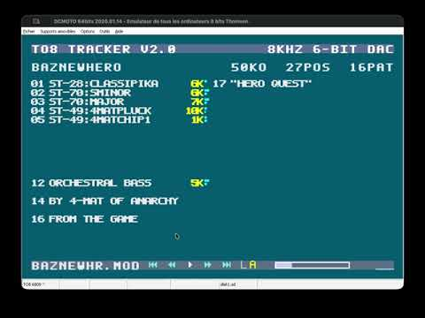
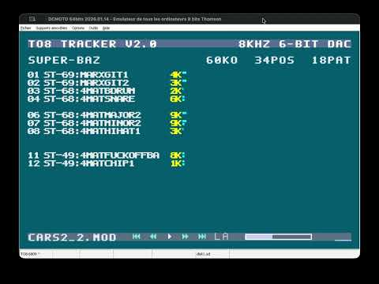
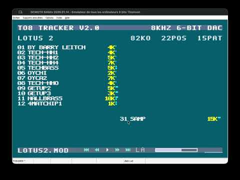
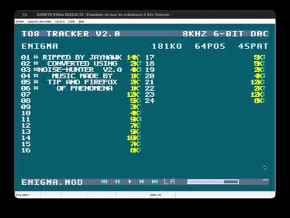
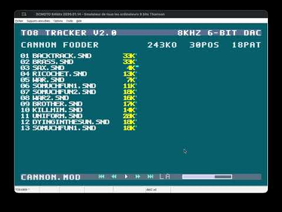
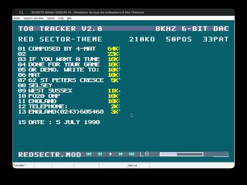

# TO8 Tracker

**Un lecteur de modules ProTracker MOD à 4 voies pour Thomson TO8 — 8 kHz, convertisseur audio 6 bits.**

TO8 Tracker fait revivre les musiques de l'Amiga sur le **Motorola 6809E à 1 MHz** du Thomson TO8, en utilisant sa sortie sonore 6 bits intégrée. Il mélange quatre voies d'échantillons entièrement par logiciel, à raison de **8 000 échantillons par seconde**.

## Démonstrations en vidéo

Cliquez sur une miniature pour regarder la vidéo correspondante sur YouTube.

| Hero Quest | SuperCars 2 |
| :---: | :---: |
|  |  |
| **Lotus 2** | **Démo Enigma** |
|  |  |
| **Cannon Fodder** | **Red Sector** |
|  |  |

Ce dépôt distribue **des versions prêtes à l'emploi**. Il ne contient ni les sources en assembleur, ni les outils de compilation.

## Téléchargement

**[Télécharger la dernière version](../../releases/latest)**

Téléchargez l'**image de disquette SDDrive** proposée dans les fichiers de la version (rubrique « Assets » sur GitHub). Les archives **Source code (zip/tar.gz)** générées automatiquement par GitHub ne sont que des copies de ce dépôt de distribution : **elles ne contiennent pas le programme à lancer**.

## Points forts

- Mélange logiciel de quatre voies ProTracker, avec une sortie audio à 8 kHz sur 6 bits.
- Fonctionne sur Thomson TO8 et TO8D avec une extension de mémoire vive de 256 Ko.
- Chargeur de démarrage natif et interface utilisateur entièrement en assembleur.
- Navigateur de modules MOD, informations sur les instruments, progression du morceau et des motifs, état de la lecture.
- Lecture/pause, passage d'un module à l'autre, modes de boucle et enchaînement automatique des morceaux.
- Prise en charge de plusieurs effets ProTracker : portamento, vibrato, glissement de volume et saut de motif.
- Rééchantillonnage tenant compte de la fréquence PAL de l'Amiga pour conserver **la hauteur des notes et la vitesse de lecture d'origine**. C'est particulièrement important pour les morceaux qui enchaînent les instruments, comme *Cannon Fodder*.
- Programme distribué sous forme compressée et décompressé par le chargeur natif au démarrage.

## Installation et utilisation

### Avec DCMOTO

1. Téléchargez l'**image de disquette SDDrive** de la dernière version.
2. Sélectionnez la machine **Thomson TO8** dans [DCMOTO](https://dcmoto.pages-perso.free.fr/emulateur/index.html).
3. Activez l'extension **SDDRIVE**.
4. Activez l'extension de **256 Ko de mémoire vive**.
5. Chargez l'image SDDrive et démarrez le TO8 émulé.
6. Sélectionnez un fichier MOD compatible dans le navigateur du programme.

### Sur un véritable Thomson TO8

Utilisez l'image de disquette fournie avec une **interface SDDrive compatible** reliée au Thomson TO8. La configuration nécessite également une extension de **256 Ko de mémoire vive** sur la machine réelle. Démarrez depuis le SDDrive, puis choisissez un module MOD dans le navigateur.

La version est distribuée au **format d'image de disquette SDDrive** ; elle n'est pas destinée à être copiée directement sur une disquette classique.

## Ajoutez vos propres musiques MOD

Les fichiers MOD présents sur les images distribuées ont été **recopiés tels quels**, sans modification ni conversion, à l'aide de **[DCFUTIL](https://dcmoto.pages-perso.free.fr/emulateur/index.html)**, disponible sur le site de DCMOTO. Cet utilitaire permet d'importer et d'exporter des fichiers dans les images de disquettes Thomson, notamment au format `.sd`. **Il ne permet pas de supprimer les fichiers** : cette opération doit être effectuée depuis le **moniteur du TO8**.

**N'hésitez pas à remplacer les musiques fournies par vos propres modules.** Des milliers de morceaux ProTracker sont disponibles sur Internet :

- **[Modland — archives ProTracker](https://ftp.modland.com/pub/modules/Protracker/)** — modules classés par compositeur.
- **[The Mod Archive](https://modarchive.org/)** — vaste collection de musiques au format module ; recherchez les fichiers ProTracker `.MOD` à quatre voies.
- **[Amiga Music Preservation](https://amp.dascene.net/)** — archives de musiques et de compositeurs Amiga, avec moteur de recherche.

Pour personnaliser une image de disquette :

1. **Conservez une copie de sauvegarde** de l'image `.sd` d'origine.
2. Démarrez la disquette dans **DCMOTO ou sur un véritable TO8**, puis utilisez le **moniteur du TO8** pour supprimer les fichiers MOD à remplacer.
3. **Ne touchez ni au secteur de démarrage ni aux fichiers système du lecteur.** Ils sont indispensables.
4. Ouvrez l'image `.sd` dans **DCFUTIL**, importez des modules ProTracker compatibles à quatre voies, puis enregistrez l'image. DCFUTIL sert à **ajouter des fichiers, pas à les supprimer**.
5. Redémarrez avec cette image, dans DCMOTO ou sur un TO8 équipé d'un SDDrive.

Pour obtenir les meilleurs résultats, choisissez des modules à **125 BPM** et de **vitesse 4 ou supérieure**. La vitesse 3 présente des limitations ; les autres tempos et certains effets peuvent être mal reproduits. La taille du module doit aussi respecter les contraintes mémoire du TO8 (voir [Compatibilité des modules MOD](#compatibilité-des-modules-mod)).

## Commandes

Le rôle des touches dépend de l'écran affiché : navigateur de fichiers, lecture ou aide.

| Touche | Action |
| --- | --- |
| **Flèches** | Naviguer dans les fichiers ou les commandes de lecture |
| **Entrée / Espace** | Démarrer la lecture, mettre en pause ou reprendre selon l'écran |
| **N / P** | Module suivant / précédent pendant la lecture |
| **P** (navigateur) | Lire tous les modules (« PLAY ALL ») |
| **L** | Changer de mode de boucle |
| **A** | Activer ou désactiver la lecture automatique |
| **H** | Afficher l'aide |
| **E** (aide) | Quitter l'aide |
| **M** (lecteur) | Revenir au navigateur de modules |

## Compatibilité des modules MOD

TO8 Tracker est conçu pour les **modules ProTracker MOD standard à quatre voies**, dans les limites de mémoire et de puissance du TO8.

- **Tempo :** la lecture est prévue pour **125 BPM**, avec 50 mises à jour musicales par seconde. Les autres valeurs de BPM ne sont pas reproduites à leur tempo d'origine.
- **Vitesse :** prise en charge normale à partir de la vitesse 4. La vitesse 3 fonctionne en mode dégradé : certains effets et l'avancement des motifs sont limités.
- **Effets :** seule une partie des commandes ProTracker est implémentée. Le vibrato est soumis aux contraintes de temps réel ; les combinaisons d'effets de hauteur et de volume peuvent être simplifiées.
- **Taille et échantillons :** les modules volumineux peuvent dépasser la mémoire disponible.
- **Qualité sonore :** les quatre voies sont mélangées à 8 kHz sur 6 bits. Les notes aiguës et les fortes décimations peuvent produire du repliement spectral audible par rapport à l'Amiga d'origine.

Tous les modules ne seront donc pas reproduits parfaitement. L'objectif est de respecter la hauteur des notes et le rythme des morceaux compatibles, dans les limites du Thomson TO8.

## Nouveautés de la version 2.0

Par rapport à la version 1.4, qui utilisait déjà la même architecture de lecture :

- Rééchantillonnage prenant en compte la fréquence PAL de l'Amiga pour respecter la hauteur des notes et la vitesse des échantillons.
- Prise en charge du vibrato.
- Prise en charge des vitesses 3 et 4, avec les restrictions indiquées plus haut.
- Nouvelle interface utilisateur et nouveau chargeur de démarrage natif, entièrement en assembleur.
- Programme unifié et distribué sous forme compressée.

Consultez la [page des versions](../../releases) pour les téléchargements et les modifications propres à chaque version.

## À propos de ce dépôt

Ce dépôt public contient les **versions exécutables de TO8 Tracker** et leur documentation. Les sources en assembleur, les outils de compilation Python et les fichiers de développement sont conservés séparément et ne sont pas publiés ici.

Les musiques au format ProTracker MOD peuvent être protégées par les droits de leurs auteurs. Veillez à respecter les autorisations de chacun lors de leur utilisation ou de leur diffusion.
